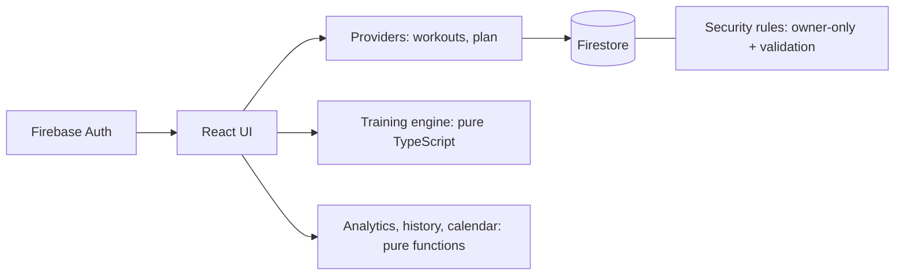

# Momentum

A running and training platform: log workouts, follow a plan built for your goal, and understand your training.
Built for my own Nelson Mandela marathon preparation, then rebuilt as a production-style app.

> General training guidance, not medical advice.

## Features
- **Log, edit, delete and backdate workouts** with shared validation (Zod in the app, security rules in the database).
- **Personalised training plans** for 5K, 10K, half marathon and marathon: distance-specific phases, steady long-run progression, cutback and taper weeks, optional race date.
- **Calendar** with completed, planned, missed and rest days, plus a day detail panel.
- **Analytics**: weekly distance, pace trend, training mix, plan consistency, CSV export.
- **Workout history** with search, filters, pagination and CSV export.
- Works on phone and desktop, installable as a PWA, and logs offline (Firestore persistence).

## Screenshots
Add these to `docs/screenshots/` (turn on demo mode below to fill the app with data):

| Overview | Calendar | Analytics |
|---|---|---|
|  |  |  |
| **Training plan** | **Workout history** | **Edit workout** |
|  |  |  |

## Stack
React 19, Vite, TypeScript, Tailwind CSS v4, React Router 7, Firebase (Auth, Firestore, Hosting), Zod, Vitest, Testing Library, GitHub Actions.

## Architecture

```
users/{uid}/workouts/{id}
users/{uid}/plans/{planId}
users/{uid}/plans/{planId}/sessions/{id}
```

## Decisions
- **Pure, tested logic.** Plan generation, analytics, calendar states and history filtering are plain functions with no React or Firebase, so the rules that matter are unit tested.
- **Derived status.** A session is completed if a run exists on its date and missed only once its date has passed. Nothing is stored that can drift, and nothing is marked missed because the app wasn't opened.
- **Safe training rules.** Weekly growth is capped at 10%, every fourth week is a cutback, beginners get no intervals, hard sessions are never next to the long run, and a race that is too close gets a warning instead of a compressed plan.
- **Validated twice.** The same limits live in Zod and in Firestore rules, so bad data is rejected even if the UI is bypassed.
- **Offline first.** Firestore persistence lets a runner log after a run with no signal.

## Run it
```bash
npm install
cp .env.example .env     # add your Firebase web app config
npm run emulators        # needs Java 11+
npm run dev
```
`VITE_USE_EMULATORS=true` uses local emulators, `false` uses your Firebase project.
**Demo mode:** set `VITE_ENABLE_DEMO=true` to get a "Load sample data" button on the Overview screen.

## Test and deploy
```bash
npm run typecheck && npm test && npm run build
firebase deploy --only firestore:rules
firebase deploy --only hosting
```

## Roadmap
Android app (Capacitor), adaptive plan adjustments, pace predictions, wearable integrations.
