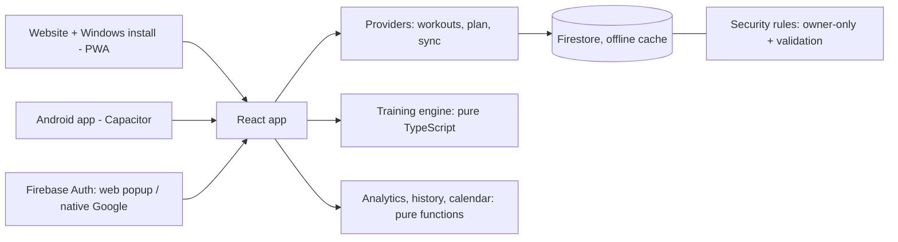

# Momentum

A running and training platform: log workouts, follow a plan built for your goal, and understand your training.
Built to track my own Nelson Mandela marathon preparation, then rebuilt from scratch as a production-style app that runs on the web, Windows and Android.

**Live app:** https://momentum-2-0.web.app

> General training guidance, not medical advice.

## Platforms
| Platform | How |
|---|---|
| **Web** | Hosted on Firebase Hosting. |
| **Windows desktop** | Install the website as an app from Edge or Chrome (it's a PWA). |
| **Android** | Capacitor wraps the same code in a native Android app, with native Google sign-in. |

One codebase and one Firebase project serve all three, so your runs and plan follow you between devices.

## Features
- **Log, edit, delete and backdate workouts** with shared validation (Zod in the app, security rules in the database).
- **Personalised training plans** for 5K, 10K, half marathon and marathon: distance-specific phases, steady long-run progression, a mix of easy, steady, tempo, interval and long runs, cutback and taper weeks, and an optional race date.
- **Calendar** with completed, planned, missed and rest days, plus a day detail panel.
- **Analytics:** weekly distance, pace trend, training mix, plan consistency and CSV export.
- **Workout history** with search, filters, pagination and CSV export.
- **Works offline:** log, edit and delete runs with no signal. Changes are saved on the device, shown straight away, and synced automatically when the connection returns, with a status banner.
- **Responsive:** bottom navigation on phones, sidebar on desktop, skip link and labelled controls for keyboard and screen reader users.

<!--
## Screenshots
Add the images to docs/screenshots/ and remove this comment markers to show them.

| Overview | Calendar | Analytics |
|---|---|---|
|  |  |  |
| **Training plan** | **Workout history** | **Edit workout** |
|  |  |  |
-->

## Stack
React 19, Vite, TypeScript, Tailwind CSS v4, React Router 7, Firebase 12 (Auth, Firestore, Hosting), Zod, Capacitor 8 (Android), vite-plugin-pwa (offline and install), Vitest, Testing Library, GitHub Actions.

## Architecture

```
users/{uid}/workouts/{id}
users/{uid}/plans/{planId}
users/{uid}/plans/{planId}/sessions/{id}
```

## Decisions
- **Pure, tested logic.** Plan generation, analytics, calendar states and history filtering are plain functions with no React or Firebase, so the rules that matter are unit tested (66 tests).
- **Derived status.** A session is completed if a run exists on its date, and missed only once its date has passed. Nothing is stored that can drift, and nothing is marked missed because the app wasn't opened.
- **Safe training rules.** Weekly growth is capped at 10%, every fourth week is a cutback, beginners get no intervals, hard sessions are never next to the long run, the long run climbs week by week, and a race that is too close gets a warning instead of a compressed plan.
- **Validated twice.** The same limits live in Zod and in Firestore rules, so bad data is rejected even if the UI is bypassed.
- **Offline writes don't block the UI.** Firestore only confirms a write once the server acknowledges it, which never happens offline. The app saves locally, stops waiting after a moment, shows the change immediately, and flags a problem later if a queued change is rejected.
- **Native sign-in on Android.** The web popup can't run in an Android app, so Google sign-in happens natively and the token is handed to the Firebase web SDK. The user ends up as the same Firebase user as on the web, so existing data carries over.
- **Updates never interrupt you.** The installed web app shows a "new version is ready" bar rather than reloading mid-entry.

## Run it
```bash
npm install
cp .env.example .env     # add your Firebase web app config
npm run emulators        # needs Java 11+
npm run dev
```
`VITE_USE_EMULATORS=true` uses local emulators, `false` uses your Firebase project.
**Demo mode:** set `VITE_ENABLE_DEMO=true` to get a "Load sample data" button on the Overview screen. Production builds turn it off.

## Test
```bash
npm run typecheck
npm test
```
`docs/TESTING.md` is a manual release checklist covering sign-in, data continuity across devices, run logging, training plans, offline behaviour and the Windows install.

## Deploy
```bash
npm run build
firebase deploy --only firestore:rules
firebase deploy --only hosting
```

## Android
Requires Android Studio and a Firebase Android app with your debug SHA-1.
1. Download `google-services.json` from Firebase into `android/app/` (it is git-ignored).
2. Build and sync:
   ```bash
   npm run build
   npx cap sync android
   cd android
   ./gradlew assembleDebug
   ```
3. Install `android/app/build/outputs/apk/debug/app-debug.apk` on a phone.

## Roadmap
- Google Play release (signed build)
- Custom date range in Analytics, pause and resume for plans, editable plan preferences
- Adaptive plan adjustments and pace predictions
- Wearable integrations